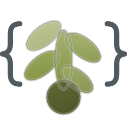

#+title: Olive CSS 🫒
#+author: Josep Bigorra
#+email: jjbigorra@gmail.com
#+options: toc:nil
#+language: en

[[https://jointhefreeworld.org/ggg/dist/scheme-guile.svg]] [[https://jointhefreeworld.org/ggg/dist/gnu-guix.svg]] [[https://jointhefreeworld.org/ggg/dist/maak.svg]] [[https://jointhefreeworld.org/ggg/dist/license-mit.svg]] [[https://github.com/jjba23/olive-css/actions/workflows/ci.yml/badge.svg][CI]]

#+attr_html: :width 160 :alt Olive CSS logo

*Utility-class CSS, written in Lisp.  Tailwind-style classes in your HTML, plain CSS out, and no npm, Node or JavaScript bundler anywhere.*

* What is Olive CSS?
:PROPERTIES:
:CUSTOM_ID: what-is-olive-css
:END:

Olive CSS is a *utility-class CSS framework*: you style a page by putting classes
such as =px-4=, =bg-jeans-blue-500= or =md:flex= on your elements, the way you
would with Tailwind CSS.  What makes it different is where those classes come
from.  The whole framework is written in *Guile Scheme*: every utility family,
value scale, state variant and colour is generated by Lisp code you can read,
override or extend, and the result is one plain =.css= file that any browser
understands.

In one sentence: *Tailwind's syntax, a Lisp engine, and a stylesheet you own.*

#+begin_src html

  Hello Olive CSS!

#+end_src

** The short version
:PROPERTIES:
:CUSTOM_ID: the-short-version
:END:

- *Familiar* :: If you know Tailwind, you already know the class names.  The
  reference lists every family Olive CSS emits.
- *Hackable* :: A build is a Scheme program.  Choose the colours, breakpoints,
  states and scales you need, or add a utility family of your own.
- *Self-contained* :: One command generates a stylesheet.  No package manager,
  no watcher, no JavaScript runtime is needed to serve it.
- *Small in production* :: The complete stylesheet is deliberately generous;
  the tree-shaker keeps only the classes your pages use, usually a few KiB.
- *Free software* :: MIT licensed, code and documentation alike.

* Quick start
:PROPERTIES:
:CUSTOM_ID: quick-start
:END:

From a checkout, build the complete stylesheet:

#+begin_src shell
guix shell -m manifest.scm -- ./bin/olive-css generate --build full
#+end_src

Load it, and point the tree-shaker at your built site for production:

#+begin_src html
<link rel="stylesheet" href="/css/olive.min.css">
#+end_src

#+begin_src shell
./bin/olive-css tree-shake --directory public --output app.min.css
#+end_src

[[file:docs/getting-started.org][Getting started]] has the four install routes, a first page and the
troubleshooting list.  Every command is in [[file:docs/cli.org][the CLI reference]].

* Ways to install
:PROPERTIES:
:CUSTOM_ID: ways-to-install
:END:

Olive CSS is packaged for the systems this project is developed and distributed
with.  Pick the route that matches the rest of your machine.  Every route
installs the Scheme library; the Nix package and the recipes in this repository
also install the =olive-css= command.

| Route                | Command                                                                              |
|----------------------+--------------------------------------------------------------------------------------|
| GNU Guix             | ~guix install -L ./guix-jointhefreeworld guile-olive-css~ (see the channel notes)     |
| Nix flake            | ~nix build github:jjba23/nix-jointhefreeworld#guile-olive-css~                       |
| Container            | ~podman build -t olive-css .~ then ~podman run --rm -it olive-css --help~            |
| Distribution package | recipes under =packaging/= for Debian, openSUSE and Arch                             |

[[file:docs/getting-started.org][Getting started]] explains what each route installs and how to build from a
plain checkout.

* Documentation
:PROPERTIES:
:CUSTOM_ID: documentation
:END:

The README stops here on purpose.  Each topic lives in =docs/=, with its own
table of contents and a link back to this page:

| Document                                  | What it covers                                                  |
|-------------------------------------------+-----------------------------------------------------------------|
| [[file:docs/index.org][Documentation index]]                      | the map of all of it                                             |
| [[file:docs/getting-started.org][Getting started]]                          | install, first page, build and prune a stylesheet                |
| [[file:docs/cli.org][Command line]]                             | =olive-css generate=, =tree-shake=, =list= and every build       |
| [[file:docs/customization.org][Customizing a build]]                      | parameters, palettes, variants, your own families                |
| [[file:docs/tree-shaking.org][Tree shaking]]                             | how production CSS shrinks to the classes a site uses            |
| [[file:docs/reference.org][Utility reference]]                        | every class family and value vocabulary                          |
| [[file:docs/comparison.org][Compared with Tailwind]]                    | feature table and the estimated parity                           |
| [[file:docs/fonts.org][Fonts]]                                    | the three libre families and how to self-host them               |
| [[file:docs/development.org][Development and releases]]                 | tasks, tests, packaging, CI and =maak release=                   |

The Guile Scheme API - signatures, exports, docstrings - is published at
https://jointhefreeworld.org/api-docs/olive-css/API.html.  Notable changes live
in [[file:CHANGELOG.org][the changelog]].

* Why the name Olive?
:PROPERTIES:
:CUSTOM_ID: why-the-name-olive
:END:

The author is Spanish, and Spain is the world's largest producer of olive oil,
so naming a libre, hackable, home-grown CSS framework after the olive tree felt
only natural.  It is a small taste of Spain in your stylesheets - and yes, you
may call it olive, oliva or aceituna, it compiles either way. 🫒

* Projects that use Olive CSS
:PROPERTIES:
:CUSTOM_ID: projects-that-use-olive-css
:END:

- Hygguile :: https://codeberg.org/jjba23/hygguile
- LucidPlan :: https://codeberg.org/jjba23/lucidplan
- WikiMusic :: https://codeberg.org/jjba23/wikimusic
- Iter Vitae :: https://codeberg.org/jjba23/iter-vitae
- Byggsteg :: https://codeberg.org/jjba23/byggsteg

* Contributing
:PROPERTIES:
:CUSTOM_ID: contributing
:END:

Bug reports, class families and new palettes are all welcome.  The quickest
loop is:

#+begin_src shell
guix shell -m manifest.scm -- maak test
guix shell -m manifest.scm -- maak build
#+end_src

[[file:docs/development.org][Development and releases]] covers the tasks, the test suite and the release
process.  Small, focused commits with a test for every behaviour, please.

This project follows the [[https://jointhefreeworld.org/ai-policy/][jointhefreeworld AI policy]].
See [[file:AI_POLICY.md][AI_POLICY.md]] for the short version. It also follows the
[[https://jointhefreeworld.org/blog/articles/personal/jointhefreeworld-code-of-conduct/index.html][jointhefreeworld code of conduct]].

Find the backlog and Kanban board at
https://lucidplan.jointhefreeworld.org/tickets/olive-css.

* License
:PROPERTIES:
:CUSTOM_ID: license
:END:

MIT License.  The source code, the generated stylesheets, the documentation and
the examples are all under the same terms; see [[file:LICENSE][LICENSE]].

If you like my work, please support me by
[[https://bmc.link/jjbigorra][buying me a cup of coffee ☕]] so I can continue with a lot
of motivation.

#+begin_src
___  _ _             ___  ___ ___
  / _ \| (_) _____    / __|/ __/ __|
 | (_) | | \ V / -_)  | (__ \__ \__ \
  \___/|_|_|\_/\___|   \___||___/___/

   λ Utility-class CSS for the Free World
#+end_src
